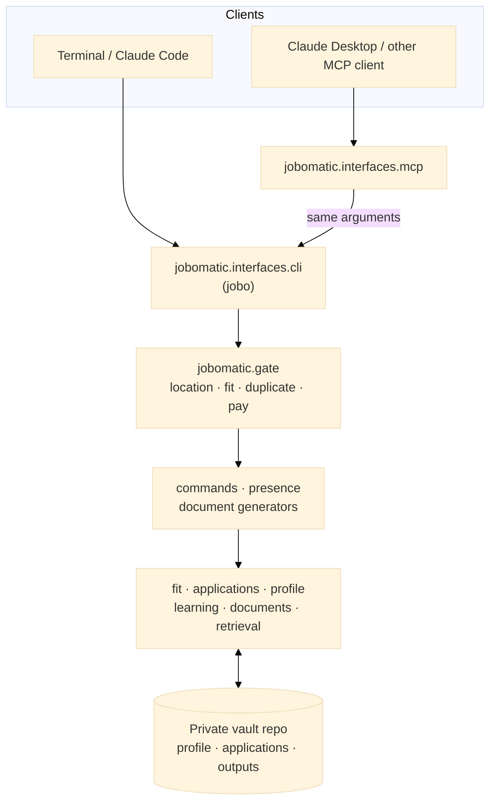

<p align="center">
  
</p>

# job-o-matic-assistant

[](https://github.com/andreak3779/job-o-matic-assistant/actions/workflows/ci.yml)

A rule-based job-search toolkit for one person's search. It rates a job posting against a typed profile, refuses weak or duplicate applications unless you confirm, and drafts tailored documents for you to review and send yourself.

> **Pre-1.0 and in active development.** job-o-matic works end to end and is used by its author for a live job search. It is not yet 1.0: command options, the profile file layout and generated-document formats can still change, and there is no migration guarantee. Commit and push your vault before you update.

**What this is**

- A command line (`jobo`), an MCP server for Claude Desktop, and skills for Claude Code, all running the same code.
- Deterministic: the same posting and profile always give the same rating and the same document content. The core commands make no language-model calls; the optional exceptions are listed in [docs/LIMITS.md](docs/LIMITS.md).
- A single-user tool, and a case study in building AI-assisted software with tests, gates and written decisions ([how it was built](docs/HOW_THIS_WAS_BUILT.md)).

**What this is not**

- Not an auto-apply tool. It never submits an application; you submit every one by hand.
- Not a scraper. It never reads job boards; you save a posting as a markdown file and give it to the tool.
- Not an applicant-screening tool. It serves the candidate's own go or no-go decision ([responsible use](docs/RESPONSIBLE_USE.md)).
- Not a multi-user product. Personal data stays in a separate private repo ([privacy](docs/PRIVACY.md)).

**Try it** (the fictional demo vault: no personal data). Not ready to install? [samples/](samples/README.md) shows real output.

```bash
git clone https://github.com/andreak3779/job-o-matic-assistant.git && cd job-o-matic-assistant
bash scripts/setup.sh                                     # Debian, Ubuntu and relatives; a minute or two
source .venv/bin/activate
export JOBOMATIC_VAULT="$PWD/demo-vault"
jobo fit-check tests/fixtures/strong-fit-jd.md            # rating: Strong
jobo generate-resume tests/fixtures/data-engineer-jd.md   # refused: the skills do not match
```

The second command exits with status 2 and a `REFUSED:` message. The refusal is the point of the tool.

**Stack.** Python, because this is command-line and MCP tooling. My .NET work is in [CookingTime](https://github.com/andreak3779/CookingTime), a .NET 10 migration with Clean Architecture and tests. Sample output for a fictional person is in [samples/](samples/README.md).

**Status.** Pre-1.0, as the note at the top says: it works for its author's live job search, and its interfaces can still change. The decisions behind it are in [docs/adr/](docs/adr/), what it guarantees in [docs/TRUTHFULNESS.md](docs/TRUTHFULNESS.md), and where its edges are in [docs/LIMITS.md](docs/LIMITS.md) and [docs/SCOPE.md](docs/SCOPE.md).

**Reviewing this project?** Start with [how it was built](docs/HOW_THIS_WAS_BUILT.md), the [architecture](docs/architecture.md) and the [decision records](docs/adr/), then see the [sample output](samples/README.md) and [what it does not do](docs/LIMITS.md).

## Architecture



Two ways in: a terminal runs `jobo` (`jobomatic.interfaces.cli.main`); an MCP client like Claude Desktop calls `jobomatic.interfaces.mcp.server`, a thin adapter that builds the same arguments the CLI takes, so both reach identical code. See [src/jobomatic/interfaces/mcp/README.md](src/jobomatic/interfaces/mcp/README.md) and [docs/architecture.md](docs/architecture.md) for the module map and the import rules that CI enforces.

**Profile model:** the candidate's facts live in the private vault as typed YAML (`profile/*.yaml`), validated on every load (`jobo profile validate`). Generators read the typed profile; the LinkedIn/GitHub/job-board generators read only its public view. See [ADR 0014](docs/adr/0014-typed-profile-store-and-rag-index-replace-bundles.md) and [ADR 0018](docs/adr/0018-visibility-declared-in-the-model.md).

**Distribution:** this repo holds code only; personal data lives in the separate private vault repo (ADR 0013).

## Skills, reference and templates

- **[skills/](skills/README.md)** — the workflows, one folder each with a `SKILL.md`: applying to a job (fit check, gap analysis, resume and cover letter, outreach, salary research), interviews (prep, mock interviews, thank-you letters), learning and profile data (Pluralsight and Microsoft Learn imports, learning-plan PDFs), and online presence (LinkedIn, GitHub, Jobgether, Indeed/ZipRecruiter, Pluralsight). They read the vault's profile and run `jobo` commands; the rules live in the code.
- **[reference/](reference/)** — material that skill steps load mid-workflow: interview question bank and rubric, writing style, coverage rubric, keyword strategy.
- **[templates/](templates/)** — the DOCX layout reference, the learning-plan role-config example, an example resume snapshot, and the Pluralsight import page.

The conventions Claude follows when using them are in [CLAUDE.md](CLAUDE.md).

## The profile

The profile is edited by hand (or by Claude, then checked) as YAML in the vault's `profile/` folder; there is no build step. `jobo profile validate` loads it and runs its consistency checks, `profile show facts|full|section ...` prints it as markdown for skills (`--public` for the public view), and `profile schema` prints the JSON Schema generated from the models.

## Install

The full guide, with what you should see at each step, is [docs/setup.md](docs/setup.md). The short
version, on Debian, Ubuntu or a system built on them:

```bash
sudo apt install -y git python3 python3-venv python3-pip     # once
git clone https://github.com/andreak3779/job-o-matic-assistant.git
cd job-o-matic-assistant
bash scripts/setup.sh
```

`setup.sh` builds `.venv`, installs the packages and runs the demo vault. It never uses `sudo` and
never touches your data. In every new terminal, run `source .venv/bin/activate` first.
`bash scripts/check-setup.sh` reports what is and is not working.

Your own data lives in a separate private **vault** repository next to this one
([Part 2](docs/setup.md#part-2-your-own-vault)). Claude Code and Desktop, page counts and evidence
search are optional ([Part 3](docs/setup.md#part-3-optional-extras)).

## CLI

The command line lives in [src/jobomatic/interfaces/cli/main.py](src/jobomatic/interfaces/cli/main.py). With the virtual environment active, `jobo` works from any folder (a relative file path starts from the folder you are in):

```bash
jobo profile validate                    # load the profile and run its consistency checks
jobo fit-check <jd.md>                   # inline fit table for a JD
jobo evidence <jd.md|"skill">            # closest evidence in your courses/projects/resume (needs a local Ollama server with nomic-embed-text; --explain adds a short rationale written by a chat model you choose, see docs/LIMITS.md)
jobo gap-analysis <jd.md>                # markdown gap-analysis report
jobo generate-resume <jd.md>             # tailored resume (add --confirm-gaps only after you say so)
jobo generate-linkedin                   # LinkedIn profile copy
jobo generate-github                     # GitHub profile copy (bio, status, README, fields, pins)
jobo generate-jobgether                  # Jobgether profile copy
jobo generate-job-board                  # Indeed & ZipRecruiter profile copy
jobo generate-pluralsight                # Pluralsight profile copy
```

Use `jobo <command> --help` for each command's options.

### MCP server

[src/jobomatic/interfaces/mcp/](src/jobomatic/interfaces/mcp/) exposes the same CLI commands as MCP tools for
Claude Desktop or any other MCP-capable client — see
[src/jobomatic/interfaces/mcp/README.md](src/jobomatic/interfaces/mcp/README.md) for install and setup.

### Fit engine

`src/jobomatic/fit/engine.py` is the deterministic rating engine used by `fit-check` and `gap-analysis`. It classifies each JD skill as production (`match`, ✅), portfolio (`portfolio`, ✅), coursework (`course`, 🟡), legacy experience (`legacy`, 🕰️) or no evidence (`gap`, 🔴) and derives an overall `Strong / Good / Worth a try / Stretch / Pass` rating. It handles multi-token phrases, years-of-experience prefixes, and a small alias map for common co-occurring terms (e.g., C# ↔ .NET, REST API ↔ ASP.NET Core Web API).

The rating is a set of counts, so the same posting always gets the same rating. Coverage is (✅ + ½ × (🟡 + 🕰️)) ÷ required skills. A *core* requirement is one named in the posting title, on one of the first five required lines, on a line with a years figure, or mentioned on two or more lines; a soft-skill line is listed, never scored, and never core. **Pass**: two or more core requirements have no evidence, or coverage is under 40%. **Stretch**: one core gap, or coverage of 40–59%. **Worth a try**: no core gap, and either a gap outside the core or three or more course-level skills. **Good**: no gaps, short of Strong's bar (any legacy-only skill caps it here). **Strong**: no gaps, at most two course-level skills, and at least two nice-to-haves. A location rule forces **Pass**. The cut-offs are starting values (ADR 0021); `fit-check` also lists soft requirements (education, years, title level and soft skills) and flags a low-confidence result when more than half the required skills have no evidence.

The engine handles:

- **Alias expansion** — common co-occurring terms (e.g., C# ↔ .NET, REST API ↔ ASP.NET Core Web API) via [`src/jobomatic/fit/aliases.json`](src/jobomatic/fit/aliases.json).
- **Compound splitting** — slashes, semicolons, "and"/"or" in JD phrases are split so partial matches register.
- **Years-prefix normalization** — "5+ years of C#" becomes "c#" before matching.
- **Genuine-gap fallback** — skills explicitly listed as known genuine gaps can still earn `portfolio` or `course` status if the gap record says so.

Alias data lives in [`src/jobomatic/fit/aliases.json`](src/jobomatic/fit/aliases.json) and the skill vocabulary in [`skill_vocabulary.json`](src/jobomatic/fit/skill_vocabulary.json) (ADR 0009). They are loaded at import time and checked by the test suite. To add a synonym pair or a skill term, edit the JSON file and run `pytest tests/test_fit_engine.py tests/test_jd_parser.py`; no Python code changes are required. Soft-skill phrases are in `soft_skill_phrases.json` (ADR 0023).

### Applications log and salary screen

Two pieces of job-search state sit beside the fit engine (ADRs [0010](docs/adr/0010-applications-log-event-sourced-explicit-applied.md) and [0011](docs/adr/0011-salary-screen-flag-not-pass.md)):

- **Applications log** — `applications/applications.jsonl` in the private vault, an append-only event log (so both laptops agree; git merges it with `merge=union`). It powers the duplicate-application check. Generating documents only records a `drafted` entry; **"applied" is set only when you say so.**

  ```bash
  jobo applications check <jd>          # NEW / DRAFTED / RELATED / REPEAT / DUPLICATE
  jobo applications applied --jd <jd> [--date YYYY-MM-DD]
  jobo applications status <id> phone_screen --next-step "Call Tue"
  jobo applications list [--status applied] [--company Acme]
  jobo applications import-csv tracker.csv --dry-run   # spreadsheet export
  ```

- **Salary screen** — `fit-check` compares a posting's stated pay with your minimums and flags (never auto-Passes) a role paying below them; resume and cover-letter generation refuses until you confirm (`--confirm-below-minimum`). The minimums live in the vault's `private/search-constraints.json` (a private repo, so it travels with the vault; template: `private/search-constraints.example.json` here), never in this repo. `jobo constraints show` prints it. The pre-commit hook fails if a minimum is ever retyped into a tracked file.
- **The document gate** (`src/jobomatic/gate.py`, run by the command line and the MCP server alike) refuses to write a tailored resume or cover letter when the fit rating is below Good, the role breaks a location rule, the posting was already applied to inside 60 days, or the stated pay is below your minimum. Stretch and Worth a try can be confirmed past with `--confirm-gaps` (tool: `confirm_gaps=true`), duplicates with `--confirm-reapply`, low pay with `--confirm-below-minimum`; set these only after you have said so. A Pass on skills and a location Pass cannot be confirmed past.

### Tests

`bash scripts/setup.sh` installs the test tools and the `mcp` package by default (skip them with
`--no-dev`). Run the full suite with:

```bash
.venv/bin/python -m pytest tests/ -q      # about a minute
```

The suite covers profile loading, the fit engine, JD parsing, and CLI smoke tests for `fit-check`, `gap-analysis`, and all five profile-update generators (`generate-linkedin`, `generate-github`, `generate-jobgether`, `generate-job-board`, `generate-pluralsight`).

## CI

`.github/workflows/ci.yml` runs on Python 3.11 with the pinned `requirements-lock.txt`:

1. `ruff check` and `ruff format --check`
2. `lint-imports`, the architecture rules (module layers, core/adapter boundaries, library boundaries)
3. `mypy src`
4. the `pytest` suite

CI has no access to the private vault, so tests use a throwaway vault built from the fictional demo data. Checks that need the real vault (`profile validate`, `scripts/check_skill_hardcoding.py`) run in the pre-commit hook; the golden-output comparison (`scripts/golden_outputs.py compare`) is run by hand after a refactor.

The workflow runs on pushes to `main`, on pull requests and by manual dispatch. The local git pre-commit hook below runs the same checks, plus the ones that need the vault, before each commit.

### Local pre-commit hook

One-time setup:

```bash
bash scripts/install-hooks.sh
```

This points `core.hooksPath` at `scripts/hooks`, so the tracked hook *is* the active hook and edits to it take effect immediately (no copy to re-install). It runs on every `git commit` and blocks it if any of these fail: the staged-file guard (generated output, `.docx`, `.pyc`, un-templated `private/` files), `scripts/check_private_values.py` (a private salary minimum retyped into a tracked file), byte-compile, `ruff check` and `ruff format --check`, `check_skill_hardcoding.py`, `jobo profile validate`, `lint-imports`, `mypy src`, and the pytest suite (about a minute). The vault-dependent checks are skipped when no vault is found. Bypass with `git commit --no-verify` only if you're deliberately committing through a known failure.

## Learning-plan PDFs

`jobo generate-learning-plan <role.json>` renders a role config to a PDF through a data-driven ReportLab engine (`src/jobomatic/documents/adapters/pdf_template.py`). Copy `templates/roles/_example.json` for the schema, keep real configs in the vault's `profile/roles/`, and the PDF is written to the path in the config's `output` key.

## Notes

- Personal data (the profile, learning history, applications log, generated documents, salary minimums) lives in the separate private vault repo, never in this one. `private/*.example.*` files here are templates, and `scripts/check_private_values.py` blocks any commit that restates a private value in a tracked file.
- Generated `*.docx` and `*.pdf` files are gitignored, and `outputs/` here is only scratch space; real outputs go to the vault.
- Skills are in [skills/](skills/README.md); the module map and import rules are in [docs/architecture.md](docs/architecture.md); the decisions behind them are in [docs/adr/](docs/adr/).
