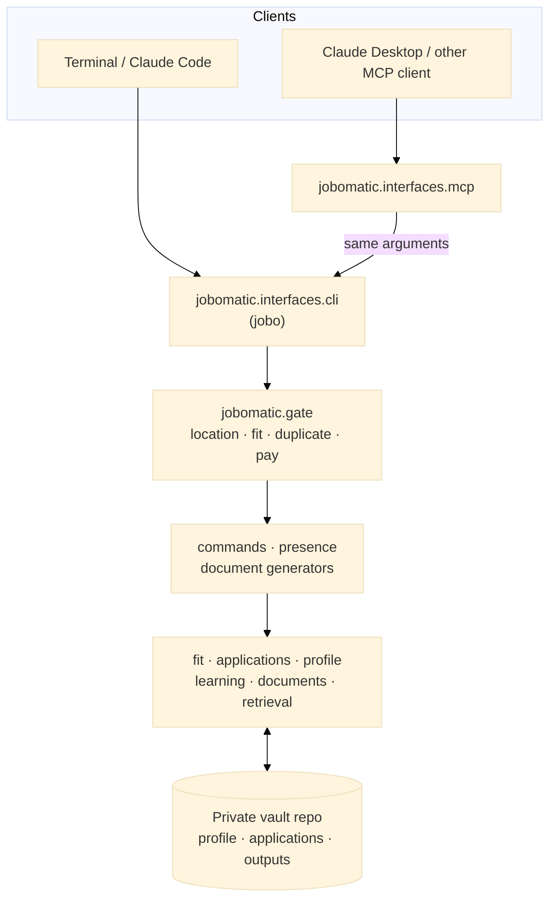
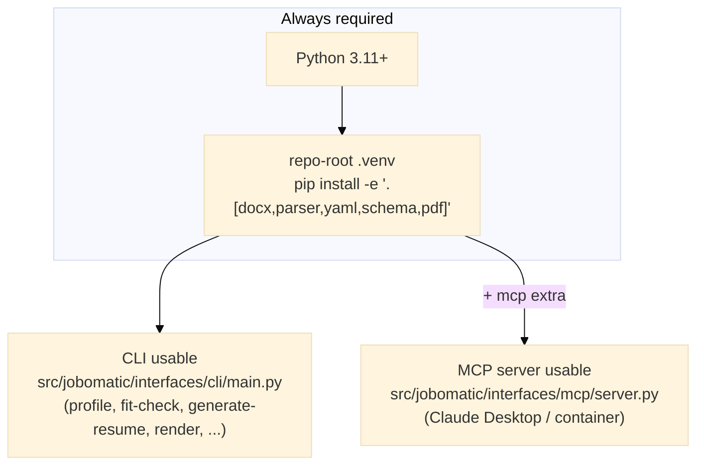

# job-o-matic-assistant

[](https://github.com/andreak3779/job-o-matic-assistant/actions/workflows/ci.yml)

A rule-based job-search toolkit for one person's search. It rates a job posting against a typed profile, refuses weak or duplicate applications unless you confirm, and drafts tailored documents for you to review and send yourself.

**What this is**

- A command line (`jobo`), an MCP server for Claude Desktop, and skills for Claude Code, all running the same code.
- Deterministic: the same posting and profile always give the same rating and the same document content. The core commands make no language-model calls; the optional exceptions are listed in [docs/LIMITS.md](docs/LIMITS.md).
- A single-user tool, and a case study in building AI-assisted software with tests, gates and written decisions ([how it was built](docs/HOW_THIS_WAS_BUILT.md)).

**What this is not**

- Not an auto-apply tool. It never submits an application; you submit every one by hand.
- Not a scraper. It never reads job boards; you save a posting as a markdown file and give it to the tool.
- Not an applicant-screening tool. It serves the candidate's own go or no-go decision ([responsible use](docs/RESPONSIBLE_USE.md)).
- Not a multi-user product. Personal data stays in a separate private repo ([privacy](docs/PRIVACY.md)).

**Try it** (uses the fictional demo vault, no personal data):

```bash
export JOBOMATIC_VAULT=$PWD/demo-vault
jobo fit-check tests/fixtures/strong-fit-jd.md        # rating: Strong
jobo generate-resume tests/fixtures/data-engineer-jd.md   # refused: the skills do not match
```

The second command exits with status 2 and a `REFUSED:` message. The refusal is the point of the tool.

**Stack.** Python, because this is command-line and MCP tooling. My .NET work is in [CookingTime](https://github.com/andreak3779/CookingTime), a .NET 10 migration with Clean Architecture and tests. Sample output for a fictional person is in [samples/](samples/README.md).

**Status.** Working, and used by its author for a live job search. The decisions behind it are in [docs/adr/](docs/adr/), what it guarantees in [docs/TRUTHFULNESS.md](docs/TRUTHFULNESS.md), and where its edges are in [docs/LIMITS.md](docs/LIMITS.md) and [docs/SCOPE.md](docs/SCOPE.md).

## Architecture



Two ways in: a terminal runs `jobo` (`jobomatic.interfaces.cli.main`); an MCP client like Claude Desktop calls `jobomatic.interfaces.mcp.server`, a thin adapter that builds the same arguments the CLI takes, so both reach identical code. See [src/jobomatic/interfaces/mcp/README.md](src/jobomatic/interfaces/mcp/README.md) and [docs/architecture.md](docs/architecture.md) for the module map and the import rules that CI enforces.

**Profile model:** the candidate's facts live in the private vault as typed YAML (`profile/*.yaml`), validated on every load (`jobo profile validate`). Generators read the typed profile; the LinkedIn/GitHub/job-board generators read only its public view. See [ADR 0014](docs/adr/0014-typed-profile-store-and-rag-index-replace-bundles.md) and [ADR 0018](docs/adr/0018-visibility-declared-in-the-model.md).

**Distribution:** this repo holds code only; personal data lives in the separate private vault repo (ADR 0013).

## Skills, reference and templates

- **[skills/](skills/README.md)** — the workflows, one folder each with a `SKILL.md`: applying to a job (fit check, gap analysis, resume and cover letter, outreach, salary research), interviews (prep, mock interviews, thank-you letters), learning and profile data (Pluralsight and Microsoft Learn imports, learning-plan PDFs), and online presence (LinkedIn, GitHub, Jobgether, Indeed/ZipRecruiter, Pluralsight). They read the vault's profile and run `jobo` commands; the rules live in the code.
- **[reference/](reference/)** — material that skill steps load mid-workflow: interview question bank and rubric, writing style, coverage rubric, keyword strategy.
- **[templates/](templates/)** — the DOCX layout reference, the learning-plan role-config example, an example resume snapshot, and the Pluralsight import page.

The conventions Claude follows when using them are in [CLAUDE.md](CLAUDE.md).

## The profile

The profile is edited by hand (or by Claude, then checked) as YAML in the vault's `profile/` folder; there is no build step. `jobo profile validate` loads it and runs its consistency checks, `profile show facts|full|section ...` prints it as markdown for skills (`--public` for the public view), and `profile schema` prints the JSON Schema generated from the models.

## Fresh OS install

The full, tested checklist is [docs/new-laptop-setup.md](docs/new-laptop-setup.md): system tools,
clone, install, the demo vault, your own vault, the commit hook, Claude Code and Desktop, page checks
with LibreOffice, evidence search with Ollama, and keeping two machines in step. The short version
is below.

Start here after a clean OS install/reimage. The toolchain is Python only. See the diagram
below, then follow the numbered steps for your use case.



1. **Python 3.11+** — check with `python3 --version`. On Debian/Ubuntu the
   venv module ships separately: `sudo apt install python3-venv` if step 2
   fails.
2. **Python setup** — see [CLI → Setup](#setup) below. Installs the
   package and its dependencies (`docx`, `parser`, `yaml`, `schema`,
   `pdf` extras) into `.venv/`.
3. **MCP server (optional, only if you use Claude Desktop)** — see
   [src/jobomatic/interfaces/mcp/README.md](src/jobomatic/interfaces/mcp/README.md#install). Adds the `mcp` extra
   on top of step 2's venv. `.mcp.json` at the repo root uses a path relative
   to the repo (`.venv/bin/python3`), so Claude Code can launch the MCP server
   on any machine as long as the venv is at `.venv/` and Claude Code is opened
   from the repo root. `claude_desktop_config.json` (a separate file, only
   needed for Claude Desktop rather than Claude Code) holds absolute paths for
   the machine it was written on — see [src/jobomatic/interfaces/mcp/README.md → Wire up Claude
   Desktop](src/jobomatic/interfaces/mcp/README.md#wire-up-claude-desktop).
4. **Your vault** — the private repo with your profile, applications log and outputs. Clone it
   next to this checkout (`../job-o-matic-vault`) or point `JOBOMATIC_VAULT` at it. For a trial
   run, `export JOBOMATIC_VAULT=$PWD/demo-vault` uses the fictional one. The `parser` extra
   (Pluralsight importer) and `pdf` extra (learning-plan PDFs) are already in step 2's command.
5. **Pre-commit hook (optional but recommended)** —
   `bash scripts/install-hooks.sh` from the repo root. See
   [Local pre-commit hook](#local-pre-commit-hook)
   below.

## CLI

### Setup

Requires Python 3.11+ — check with `python3 --version` first (see step 1
above if it's missing or too old).

**1. Navigate to the repo root:**

```bash
cd /path/to/job-o-matic-assistant
```

**2. Create the virtual environment:**

```bash
python3 -m venv .venv
```

**3. Install the package in editable mode with its extras:**

```bash
.venv/bin/pip install -c requirements-lock.txt -e ".[mcp,parser,pdf,dev,lint]"
```

Editable mode (`-e`) is required, not optional — the commands below won't
import (`ModuleNotFoundError`) without it, since the package lives under `src/` and
is found through the editable install, not a bare `PYTHONPATH`. The extras install:

- `parser` (beautifulsoup4, lxml, orjson) — reads the Pluralsight history page and Microsoft Learn pages you save, to import completed courses
- `pdf` (reportlab) — required by `generate-learning-plan`
- `mcp` — the Claude Desktop server
- `dev`, `lint` — pytest, ruff, mypy and import-linter

`mcp` is only for the Claude Desktop server (see
[src/jobomatic/interfaces/mcp/README.md](src/jobomatic/interfaces/mcp/README.md)), and `dev,lint`
for the tests and the commit hook; leave them out for a minimal install. `-c requirements-lock.txt`
pins the tested versions. `docx`, `yaml` and `schema` are core dependencies now, so they need no
extra.

**4. Verify the install:**

```bash
.venv/bin/python3 -c "import docx, bs4, yaml, jsonschema, reportlab; print('deps OK')"
```

If this prints `deps OK`, you're set. A `ModuleNotFoundError` here means the
install in step 3 didn't complete — scroll up for the failing package and
retry.

**5. Activate the venv** (`source .venv/bin/activate`) so `jobo` is on your PATH, or run
`.venv/bin/jobo`. `python -m jobomatic` does exactly the same as `jobo` without the venv on PATH.

The command line lives in [src/jobomatic/interfaces/cli/main.py](src/jobomatic/interfaces/cli/main.py). From anywhere:

```bash
jobo profile validate                    # load the profile and run its consistency checks
jobo fit-check <jd.md>                   # inline fit table for a JD
jobo evidence <jd.md|"skill">            # closest evidence in your courses/projects/resume (needs a local Ollama server with nomic-embed-text; --explain adds a short rationale written by a chat model you choose, see docs/LIMITS.md)
jobo gap-analysis <jd.md>                # markdown gap-analysis report
jobo generate-resume <jd.md>             # tailored resume (add --confirm-gaps only after you say so)
jobo generate-linkedin                   # LinkedIn profile copy
jobo generate-github                     # GitHub profile copy (bio, status, README, fields, pins)
jobo generate-jobgether                  # Jobgether profile copy
jobo generate-job-board                  # Indeed & ZipRecruiter profile copy
jobo generate-pluralsight                # Pluralsight profile copy
```

Use `jobo <command> --help` for each command's options.

### MCP server

[src/jobomatic/interfaces/mcp/](src/jobomatic/interfaces/mcp/) exposes the same CLI commands as MCP tools for
Claude Desktop or any other MCP-capable client — see
[src/jobomatic/interfaces/mcp/README.md](src/jobomatic/interfaces/mcp/README.md) for install and setup.

### Fit engine

`src/jobomatic/fit/engine.py` is the deterministic rating engine used by `fit-check` and `gap-analysis`. It classifies each JD skill as production (`match`, ✅), portfolio (`portfolio`, ✅), coursework (`course`, 🟡), legacy experience (`legacy`, 🕰️) or no evidence (`gap`, 🔴) and derives an overall `Strong / Good / Worth a try / Stretch / Pass` rating. It handles multi-token phrases, years-of-experience prefixes, and a small alias map for common co-occurring terms (e.g., C# ↔ .NET, REST API ↔ ASP.NET Core Web API).

The rating is a set of counts, so the same posting always gets the same rating. Coverage is (✅ + ½ × (🟡 + 🕰️)) ÷ required skills. A *core* requirement is one named in the posting title, on one of the first five required lines, on a line with a years figure, or mentioned on two or more lines; a soft-skill line is listed, never scored, and never core. **Pass**: two or more core requirements have no evidence, or coverage is under 40%. **Stretch**: one core gap, or coverage of 40–59%. **Worth a try**: no core gap, and either a gap outside the core or three or more course-level skills. **Good**: no gaps, short of Strong's bar (any legacy-only skill caps it here). **Strong**: no gaps, at most two course-level skills, and at least two nice-to-haves. A location rule forces **Pass**. The cut-offs are starting values (ADR 0021); `fit-check` also lists soft requirements (education, years, title level and soft skills) and flags a low-confidence result when more than half the required skills have no evidence.

The engine handles:

- **Alias expansion** — common co-occurring terms (e.g., C# ↔ .NET, REST API ↔ ASP.NET Core Web API) via [`src/jobomatic/fit/aliases.json`](src/jobomatic/fit/aliases.json).
- **Compound splitting** — slashes, semicolons, "and"/"or" in JD phrases are split so partial matches register.
- **Years-prefix normalization** — "5+ years of C#" becomes "c#" before matching.
- **Genuine-gap fallback** — skills explicitly listed as known genuine gaps can still earn `portfolio` or `course` status if the gap record says so.

Alias data lives in [`src/jobomatic/fit/aliases.json`](src/jobomatic/fit/aliases.json) and the skill vocabulary in [`skill_vocabulary.json`](src/jobomatic/fit/skill_vocabulary.json) (ADR 0009). They are loaded at import time and checked by the test suite. To add a synonym pair or a skill term, edit the JSON file and run `pytest tests/test_fit_engine.py tests/test_jd_parser.py`; no Python code changes are required. Soft-skill phrases are in `soft_skill_phrases.json` (ADR 0023).

### Applications log and salary screen

Two pieces of job-search state sit beside the fit engine (ADRs [0010](docs/adr/0010-applications-log-event-sourced-explicit-applied.md) and [0011](docs/adr/0011-salary-screen-flag-not-pass.md)):

- **Applications log** — `applications/applications.jsonl` in the private vault, an append-only event log (so both laptops agree; git merges it with `merge=union`). It powers the duplicate-application check. Generating documents only records a `drafted` entry; **"applied" is set only when you say so.**

  ```bash
  jobo applications check <jd>          # NEW / DRAFTED / RELATED / REPEAT / DUPLICATE
  jobo applications applied --jd <jd> [--date YYYY-MM-DD]
  jobo applications status <id> phone_screen --next-step "Call Tue"
  jobo applications list [--status applied] [--company Acme]
  jobo applications import-csv tracker.csv --dry-run   # spreadsheet export
  ```

- **Salary screen** — `fit-check` compares a posting's stated pay with your minimums and flags (never auto-Passes) a role paying below them; resume and cover-letter generation refuses until you confirm (`--confirm-below-minimum`). The minimums live in the vault's `private/search-constraints.json` (a private repo, so it travels with the vault; template: `private/search-constraints.example.json` here), never in this repo. `jobo constraints show` prints it. The pre-commit hook fails if a minimum is ever retyped into a tracked file.
- **The document gate** (`src/jobomatic/gate.py`, run by the command line and the MCP server alike) refuses to write a tailored resume or cover letter when the fit rating is below Good, the role breaks a location rule, the posting was already applied to inside 60 days, or the stated pay is below your minimum. Stretch and Worth a try can be confirmed past with `--confirm-gaps` (tool: `confirm_gaps=true`), duplicates with `--confirm-reapply`, low pay with `--confirm-below-minimum`; set these only after you have said so. A Pass on skills and a location Pass cannot be confirmed past.

### Tests

Requires the `dev` and `mcp` extras on top of [Setup](#setup) above —
`test_mcp_server.py` imports the `mcp` package directly:

```bash
.venv/bin/pip install -e ".[dev,mcp]"
```

Run the full suite with:

```bash
python3 -m pytest tests/ -q
```

The suite covers profile loading, the fit engine, JD parsing, and CLI smoke tests for `fit-check`, `gap-analysis`, and all five profile-update generators (`generate-linkedin`, `generate-github`, `generate-jobgether`, `generate-job-board`, `generate-pluralsight`).

## CI

`.github/workflows/ci.yml` runs on Python 3.11 with the pinned `requirements-lock.txt`:

1. `ruff check` and `ruff format --check`
2. `lint-imports`, the architecture rules (module layers, core/adapter boundaries, library boundaries)
3. `mypy src`
4. the `pytest` suite

CI has no access to the private vault, so tests use a throwaway vault built from the fictional demo data. Checks that need the real vault (`profile validate`, `scripts/check_skill_hardcoding.py`) run in the pre-commit hook; the golden-output comparison (`scripts/golden_outputs.py compare`) is run by hand after a refactor.

The workflow runs on pushes to `main`, on pull requests and by manual dispatch. The local git pre-commit hook below runs the same checks, plus the ones that need the vault, before each commit.

### Local pre-commit hook

One-time setup:

```bash
bash scripts/install-hooks.sh
```

This points `core.hooksPath` at `scripts/hooks`, so the tracked hook *is* the active hook and edits to it take effect immediately (no copy to re-install). It runs on every `git commit` and blocks it if any of these fail: the staged-file guard (generated output, `.docx`, `.pyc`, un-templated `private/` files), `scripts/check_private_values.py` (a private salary minimum retyped into a tracked file), byte-compile, `ruff check` and `ruff format --check`, `check_skill_hardcoding.py`, `jobo profile validate`, `lint-imports`, `mypy src`, and the pytest suite (about forty seconds). The vault-dependent checks are skipped when no vault is found. Bypass with `git commit --no-verify` only if you're deliberately committing through a known failure.

## Learning-plan PDFs

`jobo generate-learning-plan <role.json>` renders a role config to a PDF through a data-driven ReportLab engine (`src/jobomatic/documents/adapters/pdf_template.py`). Copy `templates/roles/_example.json` for the schema, keep real configs in the vault's `profile/roles/`, and the PDF is written to the path in the config's `output` key.

## Notes

- Personal data (the profile, learning history, applications log, generated documents, salary minimums) lives in the separate private vault repo, never in this one. `private/*.example.*` files here are templates, and `scripts/check_private_values.py` blocks any commit that restates a private value in a tracked file.
- Generated `*.docx` and `*.pdf` files are gitignored, and `outputs/` here is only scratch space; real outputs go to the vault.
- Skills are in [skills/](skills/README.md); the module map and import rules are in [docs/architecture.md](docs/architecture.md); the decisions behind them are in [docs/adr/](docs/adr/).
