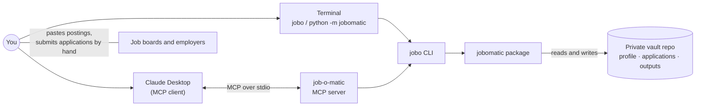
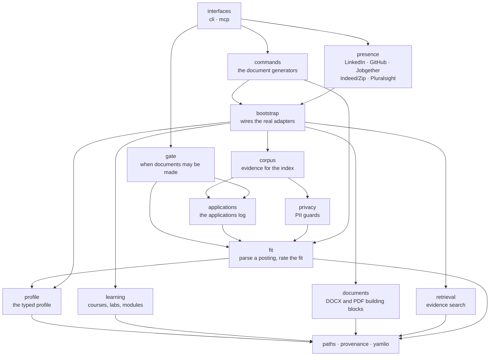
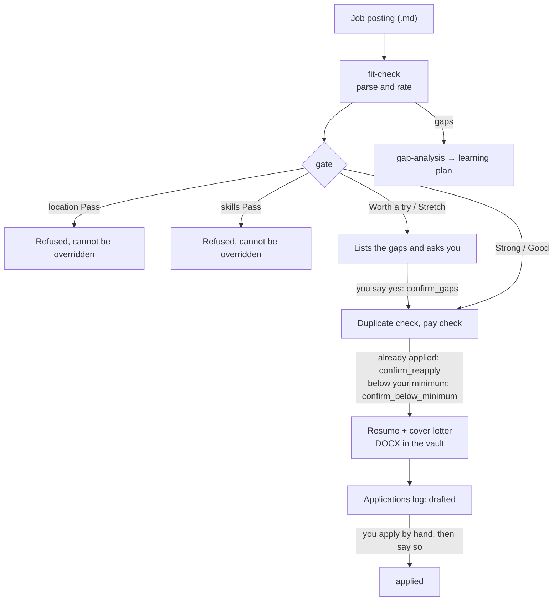

# job-o-matic-assistant — architecture

A deterministic job-search toolkit. One command line (`jobo`), one MCP server for Claude Desktop,
and a set of small modules behind them. The core commands (rating, gate, document generation) make
no language-model calls: every rating and every document can be traced back to the profile, the
posting and the rule files. The optional exceptions are listed in [LIMITS.md](LIMITS.md).

The reasoning behind each decision is in [docs/adr/](adr/) and
[quality-attributes.md](quality-attributes.md); what the tool guarantees and where it stops are in
[TRUTHFULNESS.md](TRUTHFULNESS.md) and [LIMITS.md](LIMITS.md). This page shows how the pieces fit. To install it,
see [setup.md](setup.md) and the [README](../README.md).

## Two repositories

| Repository | Holds | Visibility |
| --- | --- | --- |
| `job-o-matic-assistant` (this one) | Code, skills, reference docs, templates, tests, ADRs, fictional demo data | Public |
| `job-o-matic-vault` | The typed profile, learning history, applications log, generated documents, private rules and goldens | Always private |

The code finds the vault next to the checkout, or through `JOBOMATIC_VAULT`
([ADR 0013](adr/0013-code-and-vault-split-into-two-repos.md)). With no vault it stops with a clear
error. Tests never touch a real vault: each test gets a throwaway one built from a fictional résumé.

## System context



Nothing is network-facing ([ADR 0004](adr/0004-stdio-only-transport.md)). Postings go in and
documents come out by hand. The only network calls are optional: a local Ollama server for
embeddings, and public Microsoft Learn pages when you ask to link learning items.

## The modules

Everything lives in `src/jobomatic/`. Each box below is a module, and an arrow means "may import".
The import rules are enforced on every commit and in CI (see [Rules that are checked](#rules-that-are-checked)).



| Module | Job | Notes |
| --- | --- | --- |
| `interfaces.cli` | The `jobo` command line | One file per command group, `main.py` dispatches |
| `interfaces.mcp` | The MCP server for Claude Desktop | One tool per command; each builds the same arguments the CLI takes, so both hit the same code ([ADR 0002](adr/0002-mcp-thin-adapter-over-cli.md), [0020](adr/0020-mcp-server-for-claude-desktop.md)) |
| `commands` | One generator per document: resume, cover letter, cold outreach, job-site letter, thank-you, interview prep, gap analysis, fit check | Each is independent and shares only `commands.support` |
| `gate` | Decides whether documents may be generated: location, fit rating, duplicate, pay | Used by both interfaces, so a rule holds whoever asks |
| `presence` | The five profile-text generators | Read only the public view of the profile |
| `bootstrap` | Builds the real adapters (YAML store, learning store, index) and hands them to callers | The only place that knows which adapter goes with which port |
| `corpus` | Turns the profile and learning history into evidence chunks for the index | |
| `applications` | The applications log: model, port, use cases, JSONL and CSV adapters | Event-sourced; "applied" is always explicit ([ADR 0010](adr/0010-applications-log-event-sourced-explicit-applied.md)) |
| `privacy` | Guards that keep private values out of tracked files | |
| `fit` | Parses a posting, rates the fit, finds salary and location problems | Rules live in JSON beside the code; see below |
| `documents` | DOCX helpers and the learning-plan PDF engine | Core is free of `python-docx`; the adapters use it |
| `learning` | Pluralsight and Microsoft Learn items, imports, stats | Core is free of YAML, HTML and network code |
| `profile` | The typed profile, its visibility rules, copy fragments | Core is free of YAML ([ADR 0014](adr/0014-typed-profile-store-and-rag-index-replace-bundles.md), [0018](adr/0018-visibility-declared-in-the-model.md)) |
| `retrieval` | Hybrid keyword and embedding search over evidence | Advisory only ([ADR 0012](adr/0012-evidence-retrieval-advisory.md), [0019](adr/0019-retrieval-module-and-sqlite-index.md)) |
| `paths`, `provenance`, `yamlio` | Where data lives, a record of how an output was made, a strict YAML loader | Depend on nothing else in the package |

### Ports and adapters

The modules with data behind them (`profile`, `learning`, `documents`, `retrieval`, `applications`)
share one shape ([ADR 0016](adr/0016-modular-monolith-ports-and-adapters.md)):

```text
module/
  model.py      what the things are (pydantic or dataclasses)
  ports.py      what the module needs from the outside (a Protocol)
  service.py    the use cases, written against the ports
  adapters/     the real thing: YAML files, SQLite, HTML, DOCX
```

The core never imports its adapters. `bootstrap` is where an adapter is chosen, so a test can pass
in a fake and the core never learns the difference.

## The fit engine

A posting goes through `fit.parser` into required skills, nice-to-have skills, soft requirements,
years, level and location. `fit.engine` scores each required skill against the profile and gives it
one of four marks: ✅ proven, 🟡 partial, 🕰️ legacy experience, 🔴 missing.

Coverage is (✅ + ½ × (🟡 + 🕰️)) ÷ required skills. The rating follows from coverage and from
whether a core requirement is missing (the title, the first five required lines, the years line, or
a skill mentioned twice or more):

| Rating | Rule |
| --- | --- |
| **Strong** | Required skills well covered by proven evidence |
| **Good** | Required skills covered; a legacy mark caps a rating here |
| **Worth a try** | Real gaps, but coverage is reasonable |
| **Stretch** | One core requirement missing, or coverage 40–59% |
| **Pass** | Two or more core requirements missing, or coverage under 40% |

A role outside the location rules (Quebec, hybrid or on-site outside the home city, Atlantic-only
remote, French required) is a **Pass** whatever the skills say. Soft-skill lines are listed and
never scored ([ADR 0023](adr/0023-soft-skills-are-a-separate-unscored-block.md)). A bare "AI" requirement is
scored by the best evidence among its parts ([ADR 0022](adr/0022-umbrella-skills-scored-by-their-parts.md)).
Details and the calibration plan are in [ADR 0021](adr/0021-fit-rating-weights-core-requirements.md) and
[Fit-Calibration-Plan.md](Fit-Calibration-Plan.md).

The vocabulary, aliases, location rules and soft-skill phrases are JSON files in `src/jobomatic/fit/`.
They are not stored in the search index.

## From posting to documents



1. **Rate.** `fit-check` parses the posting and scores it against the profile, with no model call.
2. **Gate.** `jobomatic.gate` runs the location, fit, duplicate and pay checks
   ([ADR 0003](adr/0003-fit-gate-enforced-at-mcp-boundary.md), [0008](adr/0008-location-eligibility-in-fit-rating.md),
   [0010](adr/0010-applications-log-event-sourced-explicit-applied.md), [0011](adr/0011-salary-screen-flag-not-pass.md)).
   A refusal names the override that would let it through, and an override is used only after you say so.
   Location and skills Pass cannot be overridden.
3. **Generate.** The command writes into the vault's `outputs/` and records the posting as drafted.
   Nothing is logged as applied automatically.
4. **Return.** The MCP tools send back the real content, not just a path: DOCX and PDF as
   embedded resources (an attachment in Claude Desktop), reports as text.

## Where files go

```text
job-o-matic-assistant/                    job-o-matic-vault/
  src/jobomatic/   the package              profile/        typed YAML, learning items, role configs
  skills/          SKILL.md workflows       applications/   applications.jsonl
  reference/       material skills load     outputs/        applications/<date>_<company>_<role>/
  templates/       layouts and examples                     profiles/<platform>/  learning-plans/
  tests/  scripts/ docs/  demo-vault/       private/        search constraints, PII terms
  .claude/skills/  symlinks to skills/      golden/         recorded outputs for refactor checks
```

All placement decisions are in `jobomatic.paths` ([ADR 0015](adr/0015-single-outputs-hierarchy.md)).

## Running it

- **Terminal:** `jobo <command>` (or `python -m jobomatic <command>`). See [GETTING_STARTED.md](../GETTING_STARTED.md).
- **Claude Code:** the skills in `.claude/skills/` run the same commands.
- **Claude Desktop:** `jobo-mcp` (or `python -m jobomatic.interfaces.mcp.server`) over stdio, either
  directly from the virtualenv or in a Podman container with the vault bind-mounted at `/vault`
  ([ADR 0005](adr/0005-container-data-via-bind-mount.md)). Only cloud-safe evidence kinds are
  searchable from the cloud; résumé bullets and stories are `local_only`.

## Rules that are checked

`lint-imports` (import-linter) runs in the pre-commit hook and in CI. The contracts in
`pyproject.toml` fall into four groups:

| Group | What it guarantees |
| --- | --- |
| Layers | The modules above form one stack: a module uses only those below it, and siblings on the same level (for example `profile`, `learning`, `documents`, `retrieval`) never import each other |
| Cores and adapters | The core of `profile`, `learning`, `documents`, `retrieval` and `applications` imports no adapter, no `bootstrap`, no interface and no file-format library |
| Inside a module | The five presence generators, the document commands, the fit engine, parser and rule modules, and the CLI and MCP interfaces each keep their own direction |
| Libraries | `python-docx`, `reportlab`, `sqlite3`/`sqlite-vec`, `PyYAML`, `bs4`/`jsonschema` and `mcp` are imported only by the adapters or interfaces that need them |

To add a module, put it on the right layer in the layers contract, say which libraries it may use,
and run `lint-imports`. A new contract is not done until you have broken it on purpose once and
seen it fail.

Every commit also runs the private-values scan, `ruff`, `scripts/check_skill_hardcoding.py`,
`profile validate`, `mypy src` and the full test suite. CI repeats the checks that do not need a vault.
