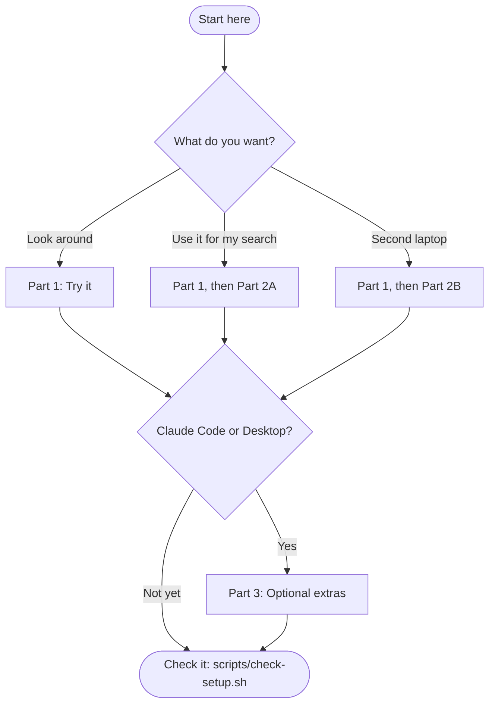

# Setting up job-o-matic

A step-by-step guide for Debian, Ubuntu and systems built on them (Linux Mint, Pop!_OS, Zorin OS).
You need a terminal, an internet connection and about 250 MB of disk. Part 1 takes about 15 minutes
and uses no personal data. Tested on Zorin OS 18 (Ubuntu 24.04 base).

> **Pre-1.0 and in active development.** job-o-matic works end to end and is used by its author for a live job search. It is not yet 1.0: command options, the profile file layout and generated-document formats can still change, and there is no migration guarantee. Commit and push your vault before you update.

This page is the **only** place the install steps are written in full. Everywhere else links here.
For what the commands do once you are set up, see [GETTING_STARTED.md](../GETTING_STARTED.md).

## Where do you want to go?



| If you want to... | Do |
| --- | --- |
| Look around, with no personal data | Part 1 |
| Use it for your own search | Part 1, then Part 2A |
| Set up a second laptop (you already have a vault) | Part 1, then Part 2B |
| Use it from Claude Code or Claude Desktop | Part 3 |
| Change the code | Part 4 |

## Words you will see

| Word | Meaning |
| --- | --- |
| **terminal** | The text window where you type commands. Open it from your applications menu, or with Ctrl+Alt+T on many systems. |
| **repository (repo)** | A folder tracked by git, a tool that records every change to it. |
| **vault** | Your private folder with your profile, applications log and generated documents. Its own repo, kept apart from the code. |
| **demo vault** | A vault for an invented person, included so you can try everything with no personal data. |
| **virtual environment (venv)** | A private folder (`.venv`) holding this project's Python packages, so nothing touches your system. It must be *activated* in each terminal. |
| **`jobo`** | The command this project gives you, available once the venv is active. |
| **MCP** | The way Claude Desktop and Claude Code call this project's tools. Optional. |
| **hook** | A check git runs before each commit. Only for people changing the code. |

## What goes where

You will have two folders side by side. Keep them that way.

```text
~/src/                               any ordinary folder (not /tmp)
├── job-o-matic-assistant/           THE CODE. Safe to share; can be public.
│   ├── scripts/setup.sh             the installer you will run
│   ├── demo-vault/                  a FICTIONAL person, for trying it out
│   └── .venv/                       made by setup.sh (not tracked by git)
└── job-o-matic-vault/               YOUR DATA. Private. Never make it public.
    ├── profile/                     your roles, skills, education
    ├── applications/                what you drafted and applied for
    ├── outputs/                     the documents it writes for you
    └── private/                     salary minimums and similar
```

The code finds the vault by itself when it sits next to the code folder, as above. Nothing about you
is ever stored in the code folder.

---

## Part 1: Try it with the demo vault

### Step 1 of 4: Install the basics

In a terminal, run these. `sudo` runs a command as the administrator, so it asks for your password
(nothing shows as you type; press Enter when done).

```bash
sudo apt update
sudo apt install -y git python3 python3-venv python3-pip
python3 --version
```

The last line must say **3.11 or newer**. The tests run on 3.11, 3.12, 3.13 and 3.14. If it says less than 3.11, find your system below.

| System | Python it ships | What to do |
| --- | --- | --- |
| Ubuntu 24.04, Linux Mint 22 (Ubuntu 24.04 base), Zorin OS 18 | 3.12 | Nothing |
| Debian 12 | 3.11 | Nothing |
| Debian 13 | 3.13 | Nothing. The tests pass on the official Python 3.13 image; Debian's own `python3` has not been run here, and the script falls back if a package will not install. |
| Ubuntu 22.04, Linux Mint 21, Pop!_OS 22.04 | 3.10 | Too old. The script prints the fix (a newer Python from the deadsnakes package source), or move to a newer release. |
| Debian 11 | 3.9 | Too old. Upgrade to Debian 12 or newer. |

*Versions as of November 2026.*

### Step 2 of 4: Get the code

```bash
mkdir -p ~/src && cd ~/src
git clone https://github.com/andreak3779/job-o-matic-assistant.git
cd job-o-matic-assistant
```

Keep it somewhere ordinary such as `~/src`, not under `/tmp`: some safety tests skip themselves
when the folder is inside the temp directory.

### Step 3 of 4: Run the setup script

```bash
bash scripts/setup.sh
```

It checks Python, builds the virtual environment, installs the packages (about 250 MB, from the
internet) and runs a short demo. It takes a minute or two and is safe to run again. It never uses
`sudo`; if something is missing it prints the command for you to run.

**What you should see** (paths shortened):

```text
job-o-matic setup
...
[1/5] Checking this computer
  OK    Ubuntu 24.04 LTS, in the Debian/Ubuntu family
  OK    Python 3.12.3 (/usr/bin/python3)

[2/5] Creating the virtual environment (.venv)
  OK    created .venv

[3/5] Installing the packages
  OK    installed with the versions the tests use (requirements-lock.txt)
...
[5/5] Trying the demo vault (a fictional candidate, no personal data)
  OK    jobo profile validate
  OK    jobo fit-check gives Strong for a matching posting
  OK    jobo generate-resume refuses a posting that does not match (exit 2). That is the tool working.

Done. job-o-matic is installed. 0 warning(s).
```

If it stops, it says **FAIL**, what went wrong and what to run. Fix that and run it again.

**What it installs.** The core packages, plus these extras (add `--no-dev` to skip the last two and
save about half the disk space):

| Extra | What it is for |
| --- | --- |
| `mcp` | The server Claude Code and Claude Desktop use (Part 3) |
| `parser` | Reading the Pluralsight and Microsoft Learn pages you save, to import completed courses |
| `pdf` | Making learning-plan PDFs |
| `web` | The local web page, `jobo web` (Part 3). Not installed unless you add `--web` |
| `dev`, `lint` | The tests, and the code checks (ruff, mypy, import-linter) |

### Step 4 of 4: Try it yourself

Run these in the code folder. The first two lines are needed **in every new terminal**:

```bash
cd ~/src/job-o-matic-assistant
source .venv/bin/activate                       # your prompt now starts with (.venv)
export JOBOMATIC_VAULT="$PWD/demo-vault"        # use the demo vault in this terminal

jobo profile validate
jobo fit-check tests/fixtures/strong-fit-jd.md
jobo generate-resume tests/fixtures/data-engineer-jd.md
```

**What you should see:**

```text
$ jobo profile validate
[WARNING] ...                       <- a few of these are normal on the demo vault
[OK] Profile valid: ...

$ jobo fit-check tests/fixtures/strong-fit-jd.md
## Fit Check — Senior Full-Stack .NET Developer at Northgate Insurance Group
...
**Fit Rating: Strong**

$ jobo generate-resume tests/fixtures/data-engineer-jd.md
REFUSED: Fit rating is Pass — refusing to generate resume/cover letter.
...
```

The `REFUSED` is the point of the tool: a posting that does not match your skills is not turned into
a resume. The command ends with exit status 2.

**To generate real files with the demo**, use a copy. Generating documents writes into the vault,
and you do not want that inside your code folder:

```bash
cp -r demo-vault ~/job-o-matic-demo
export JOBOMATIC_VAULT="$HOME/job-o-matic-demo"
jobo generate-resume tests/fixtures/strong-fit-jd.md
```

That is the end of Part 1. **Next:** [GETTING_STARTED.md](../GETTING_STARTED.md) walks through a first
session, or carry on with Part 2 to use your own data.

---

## Part 2: Your own vault

Your vault holds your contact details, work history and education dates.

**Before you put real data on this computer:**

1. **Turn on disk encryption.** Run `lsblk -f` and look for `crypto_LUKS` on the main partition. It
   is far easier to set up when you install the system than afterwards.
2. **Use a screen lock and a login password.**
3. **Never move the vault by email, chat or a shared cloud folder.** Use `git clone`.

### Part 2A: Starting from nothing

```bash
cd ~/src/job-o-matic-assistant
bash scripts/setup.sh --new-vault
```

This copies the demo vault to `~/src/job-o-matic-vault` and starts a git repository in it, on this
computer only. If git does not know who you are yet, it tells you the two lines to run first. Use
the private "noreply" address GitHub shows under Settings, Emails if you do not want your real
address in your commits.

**The copy still holds the invented person.** Replace its files in `profile/` with yours.
`identity.yaml` and `roles.yaml` are the best place to start. After every change run:

```bash
jobo profile validate
```

The profile is plain YAML, and there is no build step. Edit it by hand, or ask Claude to and then
run the check. `check-setup.sh` warns while the vault still holds the invented person.

**Back it up privately.** Install the GitHub tool, sign in, and create a **private** repository. Run
this yourself; the setup script never does:

```bash
sudo apt install -y gh
gh auth login
cd ~/src/job-o-matic-vault
gh repo create job-o-matic-vault --private --source=. --push
```

**Private limits.** Salary minimums live in the vault's `private/search-constraints.json`. A template
is in `private/search-constraints.example.json` in the code folder. Amounts are CAD and either key
may be left out; without the file the salary screen is skipped.

```bash
jobo constraints show        # prints your minimums, or says none are set
```

Do not copy the real file into the code folder: a hook blocks that.

### Part 2B: A second laptop (you already have a vault)

Do Part 1 first, then:

```bash
cd ~/src/job-o-matic-assistant
bash scripts/setup.sh --vault-url https://github.com/<you>/job-o-matic-vault.git
unset JOBOMATIC_VAULT          # the folder next to the code is found by itself
bash scripts/check-setup.sh
```

A private repository needs you signed in first (`gh auth login`, above).

### How the vault is found

In this order: the `JOBOMATIC_VAULT` setting, then `vault = "/path"` in
`~/.config/job-o-matic/config.toml`, then a folder named `job-o-matic-vault` next to the code. A
folder only counts if it holds a `.jobomatic.toml` file.

### Check it

```bash
bash scripts/check-setup.sh
```

---

## Part 3: Optional extras

None of these are needed to start. Skip whatever you do not want.

### Claude Code

`.mcp.json` in the code folder points at `.venv/bin/python3`, so it works on any machine once the
install is done. Install Claude Code ([Anthropic's documentation](https://code.claude.com/docs)),
open it **from the code folder** and approve the `job-o-matic` server when it asks.

### Claude Desktop (beta on Linux)

Anthropic released a Linux beta of Claude Desktop in mid-2026 for Ubuntu and Debian, according to
press coverage; see [Anthropic's Linux page](https://code.claude.com/docs/en/desktop-linux) for the
current install steps. Then follow
[Wire up Claude Desktop](../src/jobomatic/interfaces/mcp/README.md#wire-up-claude-desktop) and
restart Desktop, because it only reads its settings on startup. Its settings file,
`~/.config/Claude/claude_desktop_config.json`, holds paths for this computer and is never synced.

### The local web page (`jobo web`)

A browser screen for the fit check, the applications list, the Pluralsight import and the document
downloads, on your own computer only ([ADR 0025](adr/0025-simple-web-ui.md)). It is not installed
by default. Add it with `bash scripts/setup.sh --web`, then run `jobo web`. It opens your browser at
an address that works once, listens on `127.0.0.1` only, and stops when you press Ctrl+C in the
terminal. Without the extra, `jobo web` tells you what to install.

### Page counts (`--check-pages`)

A resume must be at most 2 pages and a cover letter exactly 1. `--check-pages` measures the real
page count with LibreOffice:

```bash
sudo apt install -y poppler-utils libreoffice-writer
jobo generate-resume tests/fixtures/strong-fit-jd.md --check-pages     # prints a "Pages:" line
```

Install `libreoffice-writer`, not just `libreoffice-common`: the smaller package has a `soffice` that
cannot open a Word file. If you already use the Flatpak build of LibreOffice, run
`export JOBOMATIC_LIBREOFFICE=flatpak`. Details: [ADR 0024](adr/0024-resume-page-budget.md).

### Evidence search (Ollama)

`jobo evidence` and `jobo search` find the closest course, project and resume evidence for a skill.
They need a local [Ollama](https://ollama.com) server:

```bash
ollama pull nomic-embed-text
jobo index build          # embeds new or changed evidence; rebuildable
jobo search "event-driven architecture"
```

Without Ollama, `jobo search --keyword-only` still works. Retrieval is advisory and never changes a
fit rating.

---

## Part 4: If you change the code

```bash
bash scripts/setup.sh --hooks          # or, later: bash scripts/install-hooks.sh
.venv/bin/python -m pytest -q          # about a minute; uses a throwaway copy of the demo vault
```

Two hooks are turned on. The commit hook (about 6 seconds) blocks generated or private files, scans
for your private values, and runs ruff, the import contracts and mypy. The push hook (about as long
as the tests) audits the commits you are pushing for personal identifiers and then runs the tests.
Both work without a vault (they skip the checks that need one). `git commit --no-verify` and
`git push --no-verify` skip them; use that only on purpose, and know that skipping the push hook
skips the only check on what becomes public. Pinned versions
are in `requirements-lock.txt`; the header of that file says how to regenerate it.

---

## Working across two laptops

- **Pull before you start, push when you finish**, in **both** folders: code in one, your data in the
  other.
- **The applications log merges itself.** It is append-only, one event per line, and the vault's
  `.gitattributes` keeps both laptops' lines. Two laptops adding entries between pulls do not
  conflict.
- **The evidence index is not synced.** Run `jobo index build` after pulling profile or learning
  changes.
- **Record "applied" on whichever laptop you used**, with `jobo applications applied --jd <file>`,
  then commit and push the vault so the other laptop's duplicate check agrees.
- **Generated documents** go to the vault's `outputs/` and are committed there, never to the code repo.

## Updating

This project changes often. To update:

```bash
cd ~/src/job-o-matic-vault && git add -A && git commit -m "Before updating" && git push   # a backup first
cd ~/src/job-o-matic-assistant && git pull
bash scripts/setup.sh          # safe to run again; installs anything new
jobo profile validate          # tells you if the profile layout changed
```

## When something goes wrong

Run `bash scripts/check-setup.sh` first: it names the problem. The usual ones:

| You see | Why, and what to do |
| --- | --- |
| `jobo: command not found` | The virtual environment is not active in this terminal. Run `cd ~/src/job-o-matic-assistant && source .venv/bin/activate`. This is needed in every new terminal. |
| `ERROR: No vault found` | No vault is chosen in this terminal. For the demo run `export JOBOMATIC_VAULT="$PWD/demo-vault"`; for your own, see "How the vault is found". |
| `JD file not found: ...` | A relative path starts from the folder you are in. The message shows where it looked. Run from the folder that holds the file, or give the full path. |
| The script says Python is too old | See the table in Step 1. |
| The script cannot create the virtual environment | Run `sudo apt install -y python3-venv`, then the script again. |
| `python -m jobomatic` says `No module named jobomatic` | You are using the system Python. Activate the venv first, or use `.venv/bin/jobo`. |
| `ModuleNotFoundError` after a `git pull` | Run `bash scripts/setup.sh` again. |
| `... points at <path>, which has no .jobomatic.toml` | That folder is not a vault. Fix the path, or copy the marker from `demo-vault/`. |
| `cannot count pages: ... source file could not be loaded` | A `soffice` without Writer is installed. `sudo apt install -y libreoffice-writer`. |
| `cannot count pages: 'pdfinfo' ... not found` | `sudo apt install -y poppler-utils`. |
| Commit blocked: "refusing to commit private files" | You staged something under `private/` or `outputs/`. Unstage it. |
| Commit blocked: "private value" | A name, employer, city or pay figure from your vault was typed into a tracked file. Remove it. |
| Claude Code cannot start the server | Open it from the code folder, and check that `.venv/bin/python3` exists. |
| `applications check` reports an unreadable log | A bad merge left a broken line. The error names the line in `applications.jsonl`; fix or remove it. |
